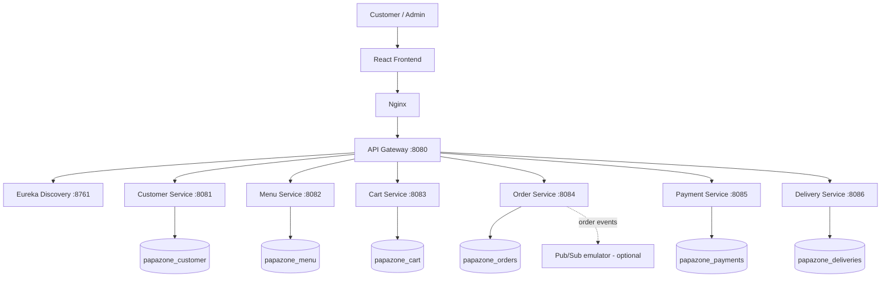

# PapaZone – Food Ordering & Delivery Platform

A runnable portfolio MVP for a Papa John's-style food ordering and delivery platform. PapaZone uses a React customer/admin interface and independently deployable Spring Boot microservices.

> **Project scope:** This is a development and portfolio MVP, not a production payment or dispatch integration. Payment and delivery-provider operations are simulated. Review the security and production-readiness notes before deploying publicly.

## Features

- Customer registration and demo login endpoints
- Menu browsing and admin menu CRUD
- Cart add, update, remove, and view operations
- Checkout and order creation
- Mock payment processing and refund endpoint
- Delivery creation, provider assignment, status updates, and tracking
- API Gateway and Eureka service discovery
- MySQL 8.0 with a separate database for each data-owning service
- Optional Google Cloud Pub/Sub emulator integration for order events, with a local log fallback
- Kubernetes deployment examples
- Swagger/OpenAPI and health-endpoint support where configured

## Technology Stack

| Area | Technologies |
|---|---|
| Backend | Java 25, Spring Boot 3.5.7, Spring Cloud 2025.0.1, Spring Data JPA |
| Service architecture | Spring Cloud Gateway, Netflix Eureka |
| Frontend | React 18, Vite, JavaScript, Axios |
| Database | MySQL 8.0 |
| Build tools | Maven 3.9+, npm |
| Containerization | Docker, Docker Compose, Nginx |
| Messaging (optional) | Google Cloud Pub/Sub emulator |
| API documentation | Swagger/OpenAPI |

## Architecture



## Requirements

- Java 25 JDK
- Maven 3.9+
- Node.js 20+
- Docker Desktop with Docker Compose
- Git

## Run with Docker Compose

Run these commands from the repository root:

```bash
docker compose build
docker compose up -d
docker compose ps
```

Open the application:

| Component | URL |
|---|---|
| React frontend | http://localhost:5173 |
| API Gateway | http://localhost:8080 |
| Eureka dashboard | http://localhost:8761 |

The API Gateway may return `404 Not Found` at its root (`/`) because application routes are defined under `/api/...`.

### Stop the application

```bash
docker compose down
```

This stops and removes the project containers and network while preserving the named MySQL volume.

> **Database warning:** Avoid `docker compose down -v` unless you intentionally want to delete this project's persisted Docker database volume. It permanently removes the Compose-managed database data.

## Service Ports

| Service | Port |
|---|---:|
| API Gateway | 8080 |
| Eureka Discovery Server | 8761 |
| Customer Service | 8081 |
| Menu Service | 8082 |
| Cart Service | 8083 |
| Order Service | 8084 |
| Payment Service | 8085 |
| Delivery Service | 8086 |
| React frontend (host) | 5173 |
| MySQL (host) | 3307 |
| Pub/Sub emulator (host) | 8087 |

Inside Docker, services connect to MySQL using the Docker service hostname `mysql` and container port `3306`. The host mapping is `3307:3306` to avoid conflict with a locally installed MySQL server that may already use host port `3306`.

## Run Locally Without Docker

1. Configure IntelliJ Project SDK, Maven importer JDK, and Maven runner JRE to JDK 25.
2. Start MySQL 8.0 and create/configure the six service databases and application user.
3. From `backend`, build all backend modules:

   ```bash
   mvn clean package -DskipTests
   ```

4. Set `PUBSUB_ENABLED=false` to use the local event-log fallback.
5. Start services in this order:
    - `discovery-server`
    - `customer-service`
    - `menu-service`
    - `cart-service`
    - `payment-service`
    - `delivery-service`
    - `order-service`
    - `api-gateway`
6. Start each backend service from its own folder:

   ```bash
   mvn spring-boot:run
   ```

7. In a separate terminal, start the frontend:

   ```bash
   cd frontend
   npm install
   npm run dev
   ```

### IntelliJ Maven Run Configuration

- **Working directory:** the specific service folder (for example, `...\backend\discovery-server`).
- **Command line:** `spring-boot:run`.
- **Maven importer JDK and Maven runner JRE:** JDK 25.

## Main API Routes

These routes are exposed through the API Gateway. The exact HTTP methods and request/response schemas should be checked against the corresponding controller implementations.

| Service | Route examples |
|---|---|
| Menu | `GET /api/menu`, `GET /api/menu/{id}`, `POST /api/menu` |
| Customer | `POST /api/customers/register`, `POST /api/customers/login` |
| Cart | `GET /api/cart/{customerId}`, `POST /api/cart/{customerId}/items`, `DELETE /api/cart/{customerId}/items/{itemId}` |
| Orders | `POST /api/orders/checkout`, `GET /api/orders/customer/{customerId}`, `GET /api/orders/{id}` |
| Payments | `POST /api/payments`, `GET /api/payments/order/{orderId}` |
| Deliveries | `POST /api/deliveries`, `GET /api/deliveries/order/{orderId}`, `PATCH /api/deliveries/{id}/status` |

Swagger UI, where enabled, is available on the individual service ports at:

```text
http://localhost:<service-port>/swagger-ui/index.html
```

## Demo Workflow

1. Register a customer or use the demo user `demo@papazone.local` if it is available in the running setup.
2. Browse the menu and add items to the cart.
3. Proceed to checkout and create an order.
4. The Order Service publishes an `order.created` event when Pub/Sub is enabled; otherwise, the event is written to the local log fallback.
5. The Delivery Service supports simulated provider assignment and delivery tracking.
6. Follow the order status through the frontend tracking experience.

## Database Configuration

Each data-owning service uses a separate MySQL database:

- `papazone_customer`
- `papazone_menu`
- `papazone_cart`
- `papazone_orders`
- `papazone_payments`
- `papazone_deliveries`

Development credentials used by the Docker Compose setup:

- **Host:** `localhost`
- **Host port:** `3307`
- **Application user:** `papazone`
- **Application password:** `papazone`

The MySQL container listens on port `3306` internally. Docker Compose maps it to host port `3307` (`3307:3306`) so it can run alongside a local MySQL instance using port `3306`.

The root password is configured through `MYSQL_ROOT_PASSWORD` in `.env`. Copy `.env.example` to `.env` and use non-default credentials for any environment beyond local development.

`database/init.sql` creates the service databases and grants the application user access. Hibernate uses `ddl-auto: update` for this development starter. Use Flyway or Liquibase migrations before production.

## Optional Pub/Sub Emulator

The Pub/Sub emulator is optional. To enable it, configure:

```properties
PUBSUB_ENABLED=true
PUBSUB_PROJECT_ID=local-project
PUBSUB_TOPIC=order-events
PUBSUB_EMULATOR_HOST=pubsub-emulator:8085
```

When Pub/Sub is disabled, order events use the local log fallback.

## Security and Production Readiness

This repository is a portfolio MVP. Before production use:

- Replace demo login/token behavior with real authentication and validated JWTs.
- Hash passwords with a modern password-hashing algorithm.
- Add role-based authorization for customer and admin operations.
- Store secrets in a secret manager; do not commit `.env` files or credentials.
- Integrate real payment processing and delivery-provider APIs with valid contracts and credentials.
- Add idempotency to checkout and payment operations.
- Add transaction/outbox patterns, retries, and dead-letter handling for reliable event processing.
- Add centralized logs, metrics, tracing, and health monitoring.
- Add database migrations with Flyway or Liquibase.
- Add automated unit, integration, and end-to-end tests.
- Complete security, privacy, and compliance reviews.

## Project Verification

The following have been exercised locally in the Docker Compose environment:

- Container startup and Eureka service registration
- MySQL connectivity
- Frontend loading and menu browsing
- Adding menu items to the cart
- Checkout and order creation
- Payment and delivery record persistence
- Delivery tracking status display

These checks are local development verification, not a substitute for automated tests or production certification.

## Author

**Ashwin Mohture**  
Software Developer | Java | Spring Boot | Microservices | React
